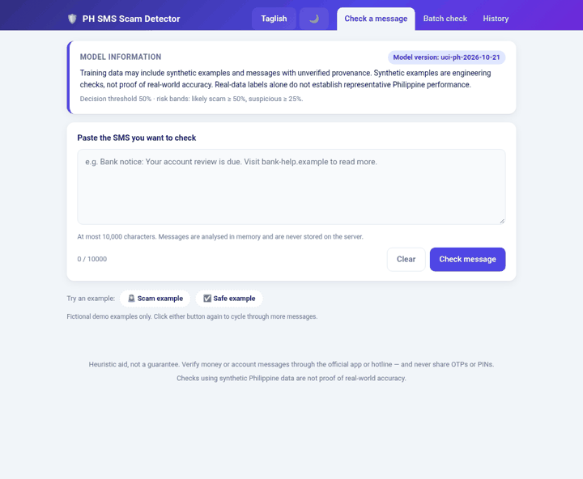
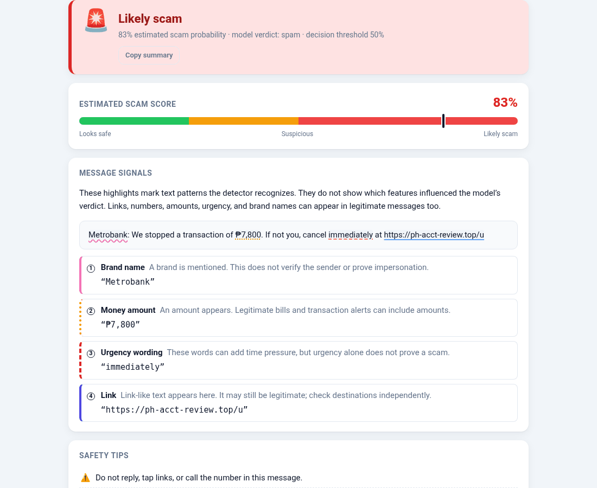
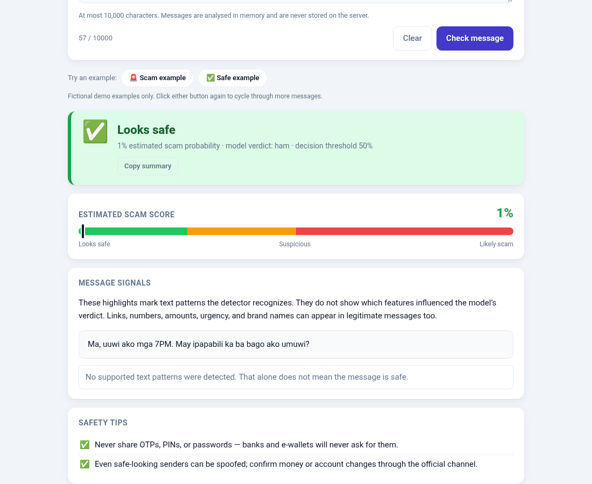
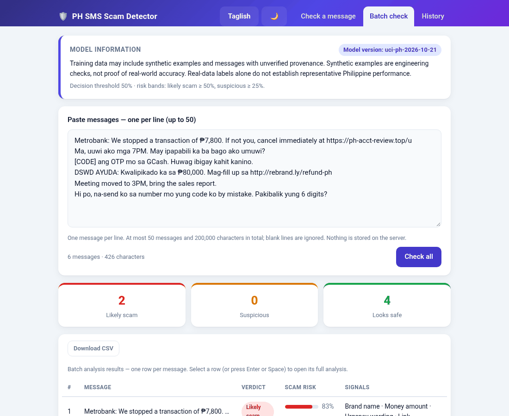
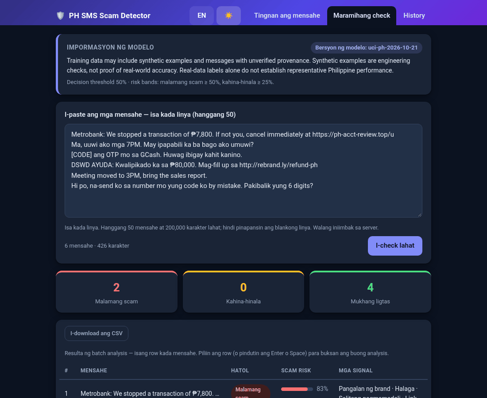

# Philippine SMS Spam and Scam Detector

An assistive spam-versus-ham SMS classifier, API, and web app for Philippine
English, Filipino, and Taglish. It combines word and character TF-IDF features
with URL, phone, money, urgency, and brand signals. Spam includes unwanted
advertising as well as suspected fraud; a calibrated spam score is not a
probability that a message is a scam. The service is FastAPI with a no-build web UI.



> **Evidence limit:** every Philippine message in this repository is synthetic,
> and the public UCI corpus is English. Scores below are engineering checks, not
> real-world accuracy. The tool is assistive only: do not block, report, or
> penalize anyone based on a prediction. Full limitations:
> [docs/MODEL_CARD.md §4](docs/MODEL_CARD.md#4-evaluation-and-the-synthetic-only-caveat).

## Quickstart

```bash
python -m venv .venv && source .venv/bin/activate
pip install -r constraints/py3.12.txt -e ".[dev]"   # or py3.11 / py3.13

# 1. Get the public UCI SMS Spam Collection (CC BY 4.0) and import it with attribution
curl -LO https://archive.ics.uci.edu/static/public/228/sms+spam+collection.zip
unzip sms+spam+collection.zip SMSSpamCollection
python -m src.import_public_dataset --input SMSSpamCollection --format uci-tsv

# 2. Train (UCI + tracked synthetic PH supplements; the synthetic PH holdout is evaluated separately)
python -m src.train --data data/raw/imported/uci_sms_spam.csv

# 3. Serve the API and web UI at http://127.0.0.1:8000 (interactive docs at /docs)
smsd-serve            # or: uvicorn api.main:app --host 127.0.0.1 --port 8000
```

No data? `make demo` trains and smoke-tests a synthetic-only model. With Docker,
train first, then run `docker compose up -d` (the model is mounted read-only; see
[DEPLOYMENT.md](docs/DEPLOYMENT.md)).

## Evaluation status

This repository does not currently contain a reproducible, versioned benchmark
run. The local base CSV and model artifacts are ignored by Git, the base
dataset's provenance is unknown, and the imported UCI file referenced in older
run notes is not present in this workspace. Earlier performance numbers could
not be matched to a current artifact and fixed evaluation membership, so they
are not presented as current results. The tracked Philippine training and
holdout messages are synthetic diagnostics only; they do not establish
real-world Philippine reliability. See the
[dataset inventory](docs/DATASET_INVENTORY.md) for current workspace counts and
the data needed for an independently reproducible evaluation.

| | |
|---|---|
|  |  |
|  |  |

## API

| Endpoint | Purpose |
|---|---|
| `GET /health`, `GET /ready` | Liveness; readiness (loads and validates the model) |
| `GET /model-info` | Version, threshold, risk bands, provenance, caveats |
| `POST /predict` | Label, score with a `probability_calibrated` indicator, flags, threshold |
| `POST /analyze`, `POST /analyze/batch` | Adds risk band, highlighted signals, model version, and both risk thresholds per result; batch takes up to 50 |
| `POST /feedback` | Optional anonymous label correction, off by default; never accepts message text |

## Web UI

The browser UI supports single-message checks, batch checks, and **Compare
messages**. Comparison sends two messages together through the existing
`POST /analyze/batch` endpoint, displays both independent model results and
their detected text patterns, and summarizes signal types present in both or
only one. It shows a percentage-point score difference only when both results
have the same model version, the same known calibration state, and valid scores;
otherwise it says they cannot be compared directly. A lower score is not a
safety guarantee. Comparison inputs and results are not added to history.

Fictional OTP, delivery, and bank/e-wallet comparison pairs are examples in the
UI only. They use placeholders and reserved `.example` domains and are not
training or evaluation data. The existing history feature remains opt-in and
browser-local.

Analysis results also offer an optional **Message Safety Checklist** with
practical next steps for unexpected requests, credential sharing, opened links,
or sent payments. Its categorical answers stay in page memory; they do not
change the model score, enter history, or go to the API. The feature appears in
single-message results, batch row details, and each comparison result card.
Copying guidance is explicit and copies recommendations only, without SMS text
or checklist answers.

```bash
curl -X POST http://127.0.0.1:8000/predict -H 'Content-Type: application/json' \
  -d '{"message":"BDO: Your account is locked. Verify here: http://bit.ly/fakebdo"}'
```

## Development

```bash
pytest -q && ruff check . && ruff format --check . && mypy src api
```

`make help` lists common commands. `python -m src.train --help` and
`python -m src.evaluate --help` list every option.

Release checks build and install the wheel in a temporary environment outside
the checkout with `python scripts/wheel_smoke.py`. The UI behavior suite uses a
development-only Playwright dependency: run `npm ci`, install Chromium with
`npx playwright install chromium`, then run `npm run test:browser`. It uses a
temporary server and synthetic browser responses; it does not add training data
or exercise the serving model.

## Adding consented Philippine messages

No consented Philippine messages are currently included. Use the blank
[intake template](data/templates/consented_ph_sms_template.csv) only in an
approved encrypted workspace, verify revocable consent and its permitted use,
redact personal details, and have two reviewers label each message with an
independent adjudicator for disagreements. Keep consent records separate from
message data, apply a retention deadline, and remove derived artifacts when
consent is withdrawn. Run the local-only preflight before using a batch:

```bash
python -m src.consented_data /secure/workspace/consented_batch.csv --purpose training
python -m src.import_consented \
  --input /secure/workspace/consented_batch.csv \
  --purpose training \
  --output-dir /secure/workspace/approved
```

The importer rechecks the same schema and rules against the exact input it
writes. Header matching is case-insensitive and treats spaces as underscores;
label aliases such as `legitimate`/`legit` and `scam` normalize to `ham` and
`spam`. Both commands report aggregate counts and row/rule codes only; they
cannot prove consent or detect every identifier. Keep a campaign-separated
evaluation batch out of training and threshold selection. See
[docs/DATA_COLLECTION.md](docs/DATA_COLLECTION.md) for the full workflow and
privacy limits.

## Documentation

[Model card and limitations](docs/MODEL_CARD.md) ·
[Data collection and consented import](docs/DATA_COLLECTION.md) ·
[Dataset inventory](docs/DATASET_INVENTORY.md) ·
[Deployment](docs/DEPLOYMENT.md) · [Retraining](docs/RETRAINING.md) ·
[Privacy](docs/PRIVACY.md) · [Human review](docs/HUMAN_REVIEW.md)

```text
src/             data validation, features, model selection, training, metrics, inference
api/             FastAPI app (main, routes, schemas) and api/web/ single-page UI
data/raw/        tracked synthetic PH fixtures; real data and imports are git-ignored
data/templates/  consented-collection template
scripts/         synthetic data generation, curation, demo smoke test
docs/            model card, data, deployment, privacy, retraining, review
```
