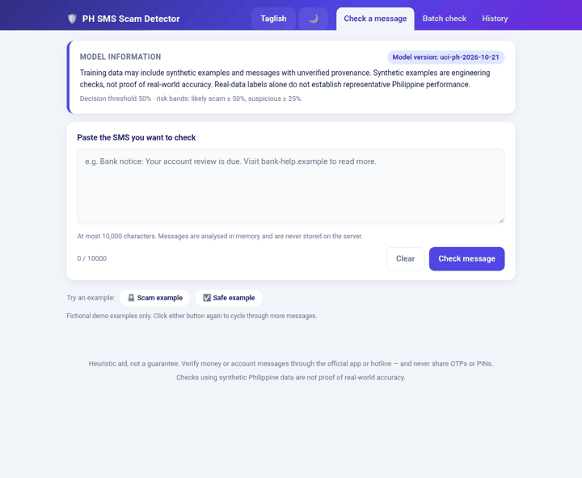
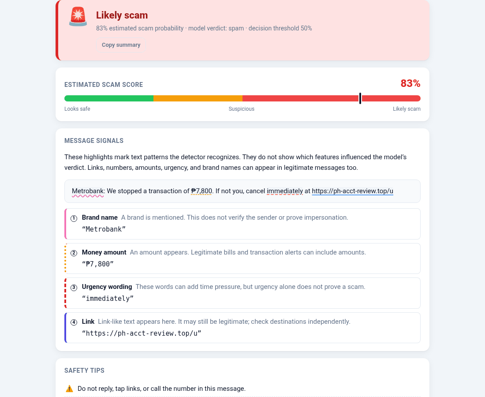
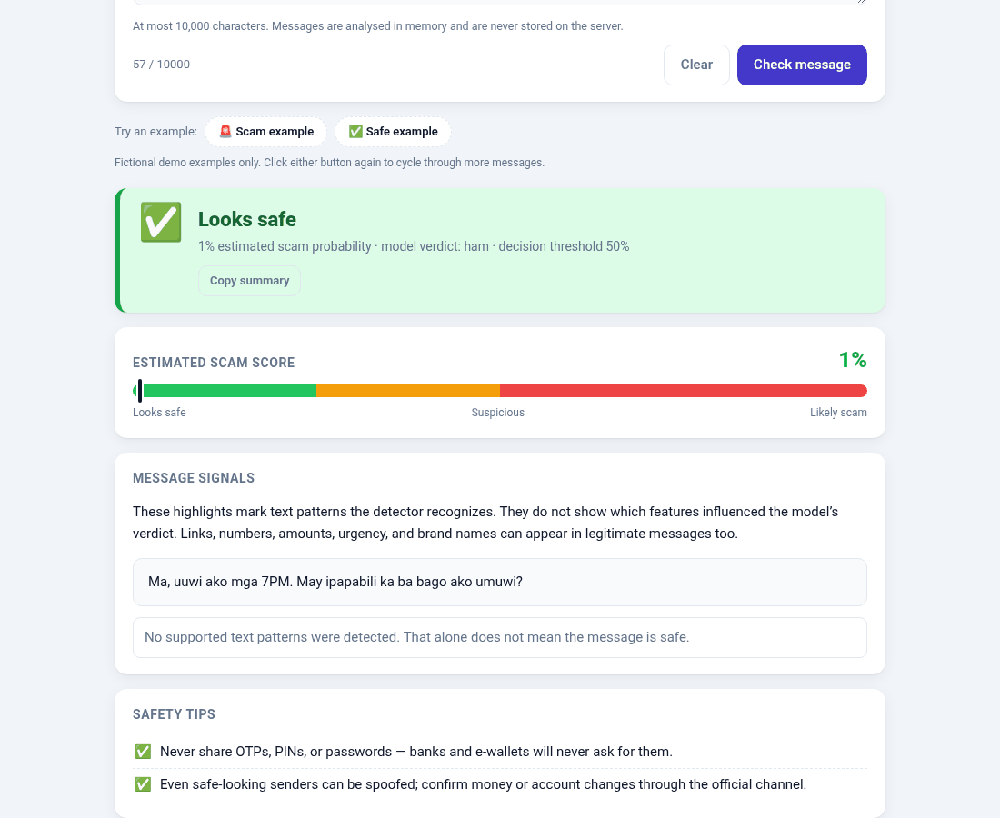
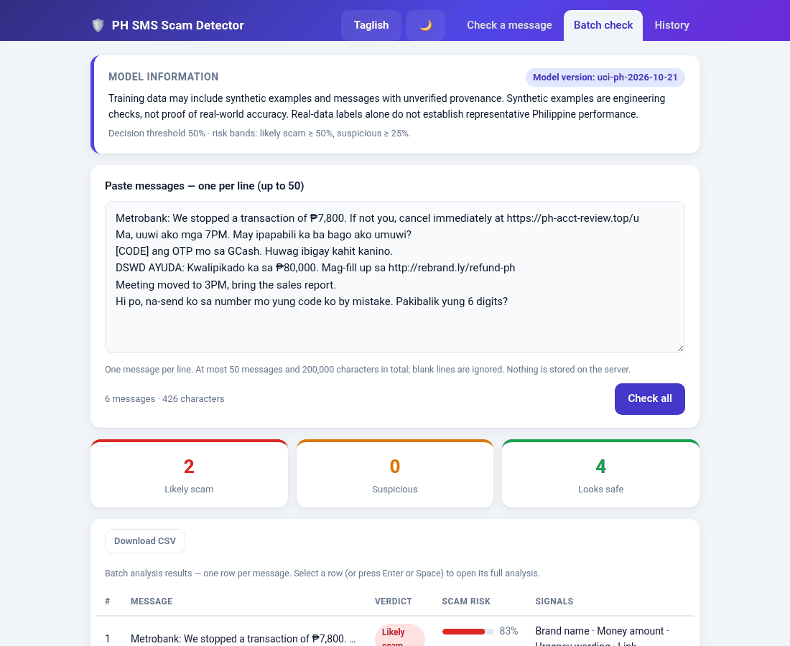
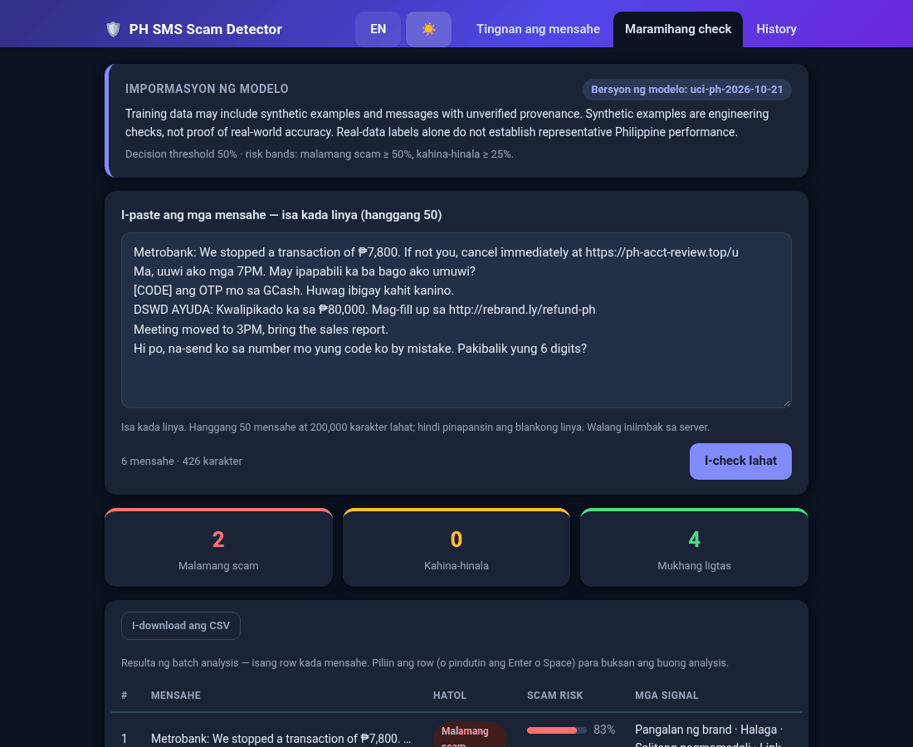

# Philippine SMS Spam and Scam Detector

An assistive spam-versus-ham SMS classifier, API, and web app for Philippine
English, Filipino, and Taglish. It combines word and character TF-IDF features
with URL, phone, money, urgency, and brand signals. Spam includes unwanted
advertising as well as suspected fraud; a calibrated spam score is not a
probability that a message is a scam. The service is FastAPI with a no-build web UI.



> **Evidence limit:** every Philippine message tracked in this repository is synthetic,
> and the public UCI corpus is English. A public one-person Philippine inbox
> has been retrieved locally (1,664 normalized rows) but has not been evaluated
> and is not representative. Existing scores are
> engineering checks, not real-world accuracy. The tool is assistive only: do not block, report, or
> penalize anyone based on a prediction. Full limitations:
> [docs/MODEL_CARD.md §4](docs/MODEL_CARD.md#4-evaluation-and-the-synthetic-only-caveat).

## Quickstart

```bash
python -m venv .venv && source .venv/bin/activate
pip install -r constraints/py3.12.txt -e ".[dev]"   # or py3.11 / py3.13

# 1. Get the public UCI SMS Spam Collection (CC BY 4.0) and import it with attribution
curl -LO https://archive.ics.uci.edu/static/public/228/sms+spam+collection.zip
unzip sms+spam+collection.zip SMSSpamCollection
python -m src.import_public_dataset --input SMSSpamCollection --format uci-tsv

# 2. Train (UCI + tracked synthetic PH supplements; the synthetic PH holdout is evaluated separately)
python -m src.train --data data/raw/imported/uci_sms_spam.csv

# 3. Serve the API and web UI at http://127.0.0.1:8000 (interactive docs at /docs)
smsd-serve            # or: make serve from the repository root
```

Run the command in a terminal and leave that terminal open while using the
site; the local server runs in the foreground and stops when you press
Ctrl-C or close the terminal. If startup reports missing packages, run
`make dev-install`. If the model file is missing, the UI still opens but
analysis remains unavailable; train a model with the command above or point
`SMSD_MODEL_PATH` at a trusted model artifact.

No data? `make demo` trains and smoke-tests a synthetic-only model. With Docker,
train first, then run `docker compose up -d` (the model is mounted read-only; see
[DEPLOYMENT.md](docs/DEPLOYMENT.md)).

For a single reproducible training-and-report run, use `make benchmark DATA=...`
with an explicit approved CSV and a fresh output directory. The command validates
the selected files, trains the candidate, evaluates the same group split, and
writes the artifact, metadata, manifest, and message-free report together. Add
`SUPPLEMENTS="..."` or `HOLDOUT=...` to include explicit sources; it never adds
the project synthetic fixtures implicitly. See [BENCHMARKING.md](docs/BENCHMARKING.md).

On macOS, keep a server running across terminal closures with
`make macos-install`; use `make macos-status`, `make macos-restart`,
`make macos-stop`, or `make macos-uninstall` to manage it. The LaunchAgent stays
bound to `127.0.0.1` and restarts after unexpected process exits.

## Evaluation status

The historical [UCI + synthetic diagnostic report](docs/benchmarks/uci-synthetic-ph-diagnostic-20261022.json)
records the exact model and input hashes, configuration, split fingerprints,
dependencies, coverage, errors, and uncertainty; it was generated from a
working tree with uncommitted changes (`source_tree_clean` is false). A clean
run on current `main` is recorded in the [clean-main report](docs/benchmarks/clean-main-6ac6a795-20261101.json)
and its [near-duplicate audit](docs/benchmarks/clean-main-6ac6a795-20261101-near-duplicate-audit.json).
The clean run separates public English corpus results from tracked synthetic
fixtures and uses a synthetic-only holdout. Its grouped split has no exact,
normalized, or group overlap, but a heuristic screen found 14 high-similarity
candidate pairs across internal splits; see the audit for details. Both
reports are engineering diagnostics, not evidence of real-world Philippine
reliability. No consented Philippine messages are available, so claims about
real-world performance remain blocked. See the
[dataset inventory](docs/DATASET_INVENTORY.md) and
[benchmark runbook](docs/BENCHMARKING.md).

The [PH Spam + Marketing SMS dataset](https://www.kaggle.com/datasets/scottleechua/ph-spam-marketing-sms-w-timestamps)
(CC BY 4.0 per its [publisher README](https://github.com/scottleechua/data/tree/main/spam-and-marketing-sms)) and [Tagalog-SMS](https://www.kaggle.com/datasets/onzero0/tagalog-sms)
(CC0 per Kaggle metadata) are available for local diagnostics. The PH inbox was
retrieved locally (8,895 raw rows; 1,664 normalized labeled rows) but has not
been evaluated. Each corpus is a single person's inbox, not a representative
Philippine sample. Use `make datasets` to fetch the first
corpus directly from its public GitHub CSV (no Kaggle credentials required), or
`make datasets DATASET=tagalog-sms` for the Kaggle-hosted second corpus
(Kaggle credentials required), followed by
`make eval DATA=... MODEL=...`; results remain separate from each other, synthetic data,
and consented data. Tagalog-SMS raw downloads contain sender metadata; its
normalizer drops that column, but the raw file must remain protected and local.
The merged Hugging Face
Filipino corpus remains blocked: its Space-level MIT tag coexists with CC BY
4.0, CC BY-NC-SA 4.0, and BSD 3-Clause source terms, and the merged message
rights and compatible reuse basis are unresolved. See
[evaluation methodology](docs/evaluation.md) for attribution, report fields,
and limits. Other supplied resources and their reuse/suitability findings are
listed in [the external-data inventory](data/external/README.md).

| | |
|---|---|
|  |  |
|  |  |

## API

Versioned routes are mounted at `/v1/*` with root aliases (`/*`) preserved for backwards compatibility:

| Endpoint | Purpose |
|---|---|
| `GET /health`, `GET /ready` (or `/v1/*`) | Liveness; readiness (loads and validates the model) |
| `GET /model-info` (or `/v1/model-info`) | Version, threshold, risk bands, provenance, caveats |
| `POST /predict` (or `/v1/predict`) | Label, score with a `probability_calibrated` indicator, flags, threshold |
| `POST /analyze`, `POST /analyze/batch` (or `/v1/*`) | Adds risk band, highlighted signals, model version, and both risk thresholds per result; batch takes up to 50 |
| `POST /feedback` (or `/v1/feedback`) | Optional anonymous label correction, off by default; never accepts message text |
| `GET /donate`, `POST /donate`, `DELETE /donate` (JSON withdrawal ID), `GET /privacy-notice` | Separate local donation workflow; disabled by default, loopback-only, unavailable in production, consent-gated, and PII-screened |

Anonymous prediction endpoints are capped at 60 requests per minute per direct
client address by default (`SMSD_RATE_LIMIT_PER_MINUTE`). This in-process limit
is a fallback for a single worker; multi-worker or reverse-proxy deployments
must also enforce a shared limit at the gateway. The app does not trust
forwarded-IP headers for identity.

Donation intake is separate from ordinary prediction and analysis, which remain
memory-only. It has no authentication, accepts only loopback clients, and is
unavailable in production mode. Do not expose it through a public reverse proxy.
Configure `SMSD_DONATIONS_ENABLED=1` and
`SMSD_DONATIONS_OPERATOR_CONTACT` only for a reviewed, protected local workflow.
Accepted records are kept in local SQLite for up to 90 days and require explicit
withdrawal or human review; they are not automatically used as model labels.
See the [collection operator guide](docs/DONATION_INTAKE.md) and
[versioned privacy notice](docs/privacy-notice.md).

## Web UI

The browser UI supports single-message checks, batch checks, and **Compare
messages**. Comparison sends two messages together through the existing
`POST /analyze/batch` endpoint, displays both independent model results and
their detected text patterns, and summarizes signal types present in both or
only one. It shows a percentage-point score difference only when both results
have the same model version, the same known calibration state, and valid scores;
otherwise it says they cannot be compared directly. A lower score is not a
safety guarantee. Comparison inputs and results are not added to history.

Single-message demo examples are curated from tracked synthetic Philippine
training fixtures in `ph_supplement_4.csv` and `ph_supplement_5.csv`. They use
masked values and only the reserved `example.com` domain; they are fictional,
not real inbox messages, and their results are not performance evidence.
Separate OTP, delivery, and bank/e-wallet comparison pairs are fictional UI-only
examples and are not training or evaluation data. The existing history feature
remains opt-in and browser-local.

The optional **Privacy Preview** runs in the browser before analysis. It suggests
possible Philippine phone numbers, email addresses, context-labeled verification
codes, and account or transaction references. Review each suggestion, reject
false positives, or select additional text to mask manually. The preview shows
the exact trimmed text that will be submitted. Confirming it replaces the
message in the input with the reviewed version; only that version is sent. The
same per-message review is available for comparison and batch inputs. Entries
left unreviewed in a batch are submitted unchanged. Detection can miss personal
details or suggest harmless text, and masking can change the detector's result;
it does not guarantee anonymization. The ordinary analysis actions remain
available for messages the user chooses to submit as written.

Analysis results also offer an optional **Message Safety Checklist** with
practical next steps for unexpected requests, credential sharing, opened links,
or sent payments. Its categorical answers stay in page memory; they do not
change the model score, enter history, or go to the API. The feature appears in
single-message results, batch row details, and each comparison result card.
Copying guidance is explicit and copies recommendations only, without SMS text
or checklist answers.

```bash
curl -X POST http://127.0.0.1:8000/predict -H 'Content-Type: application/json' \
  -d '{"message":"BDO: Your account is locked. Verify here: http://bit.ly/fakebdo"}'
```

## Development

```bash
pytest -q && ruff check . && ruff format --check . && mypy src api
```

`make help` lists common commands. `python -m src.train --help` and
`python -m src.evaluate --help` and `python -m src.benchmark --help` list every
option.

Release checks build and install the wheel in a temporary environment outside
the checkout with `python scripts/wheel_smoke.py`. The UI behavior suite uses a
development-only Playwright dependency: run `npm ci`, install Chromium with
`npx playwright install chromium`, then run `npm run test:modules` and
`npm run test:browser`. The suite
checks mocked UI states and also trains a temporary model from the tracked
synthetic Philippine fixtures to exercise real localhost analysis, missing
model readiness, service failure/recovery, and page reflow without an external
network connection. It also exercises a real missing-model 503 and cancellation
of an in-flight analysis response. The temporary artifact is deleted after the
run. Automated keyboard, layout, and contrast checks do not replace manual
screen-reader testing.

## Preparing consented Philippine data

No independently reviewed, consented Philippine corpus or trained model
artifact is available yet. The optional donation form is separate from
prediction, disabled by default, local-only, and unavailable in production.
Donations are only a pending-review queue; the application never adds them to
training automatically. Do not solicit or contact participants as part of this
project change.

To exercise the technical path without real data, run `make rehearse-consented`.
It generates fictional submissions, blind reviews, development/test splits, a
temporary model, and one synthetic evaluation; it prints aggregate diagnostics
only and removes all temporary files. The results are not consented participant
data or evidence of Philippine detector performance.

The approved workflow requires explicit review/sharing and model-research
consent, manual PII review, two blind independent spam/ham and scam reviews,
and independent adjudication of disagreements. Keep the consent register
separate from messages and use campaign/template groups without donor or sender
identifiers. Validate and split only in private local storage:

```bash
.venv/bin/python -m src.consented_data /secure/inbox/approved-reviewed.csv --purpose training
.venv/bin/python -m src.consented_data /secure/inbox/approved-reviewed.csv --purpose evaluation
make split-consented \
  DATA=/secure/inbox/approved-reviewed.csv \
  DEVELOPMENT_DIR=/secure/development \
  EVALUATION_DIR=/secure/sealed-test
```

Train on development data only; register a hash-bound evaluation plan before a
separate custodian opens the chronological campaign-separated test file. The
evaluator blocks with a content-free readiness report when model provenance,
consent, review, coverage, or uncertainty requirements fail. See
[DATA_COLLECTION.md](docs/DATA_COLLECTION.md) and
[evaluation.md](docs/evaluation.md) for the full process and limitations. The
workflow does not establish legal compliance; obtain qualified privacy/legal
review before operating collection.

Before collecting any real message, the project owner must sign the
pre-collection go/no-go record after qualified privacy/legal review. Resolve
controller/contact, lawful basis, access, retention, withdrawal, backup
deletion, and incident handling; name the data steward, two blind labelers, and
sealed-test custodian. Campaign grouping limits template leakage but cannot
prove contributor-level independence. This repository sets no study
sample-size target; the owner and reviewer must justify and register coverage
and uncertainty criteria before the sealed test is opened.

## Documentation

[System architecture](docs/ARCHITECTURE.md) ·
[Model card and limitations](docs/MODEL_CARD.md) ·
[Data collection and consented import](docs/DATA_COLLECTION.md) ·
[Local donation intake](docs/DONATION_INTAKE.md) ·
[Donor privacy notice](docs/privacy-notice.md) ·
[Reproducible benchmark reports](docs/BENCHMARKING.md) ·
[Evaluation datasets and consented holdout](docs/evaluation.md) ·
[Dataset inventory](docs/DATASET_INVENTORY.md) ·
[Deployment](docs/DEPLOYMENT.md) · [Retraining](docs/RETRAINING.md) ·
[Privacy](docs/PRIVACY.md) · [Human review](docs/HUMAN_REVIEW.md) ·
[Improvement execution record](docs/IMPROVEMENT_EXECUTION.md) ·
[Consent-study rehearsal](docs/evaluation.md#consented-philippine-evaluation-gate)

```text
src/             data validation, features, model selection, training, metrics, inference, benchmark runner
api/             FastAPI app (main, routes, schemas), macOS service helper, and api/web/ no-build UI modules
data/raw/        tracked synthetic PH fixtures; real data and imports are git-ignored
data/templates/  consented-collection template
scripts/         synthetic data generation, curation, demo, package smoke test
docs/            model card, data, deployment, privacy, retraining, review
```
