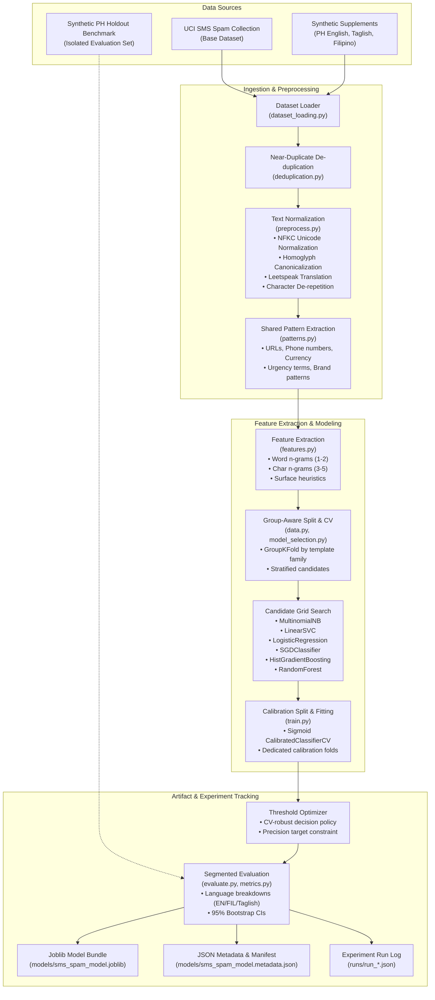

# System Architecture & Design

This document details the architectural blueprint of the Philippine SMS Spam and Scam Detector (`philippine-sms-spam-detector` v2.0.0), covering offline dataset processing & training pipelines, runtime inference services, web interface integration, and active learning feedback loops.

---

## 1. Offline ML Pipeline & Model Training Flow

The offline training subsystem loads, normalizes, extracts features, performs hyperparameter model selection, evaluates with group-aware cross-validation, calibrates probability estimates, and exports a production bundle.



By default, `src.predict` uses the calibrated linear bundle only and does not
load PyTorch or Transformers. An operator can opt into a local XLM-RoBERTa
checkpoint with `SMSD_TRANSFORMER_MODEL_PATH`; only messages inside the
configured band around the linear threshold are routed there. The model is
loaded lazily from local files, and each result identifies `model_path` as
`linear` or `ensemble`.
Transformer-routed decisions use the checkpoint's validation-selected
threshold, and their raw scores are marked uncalibrated. The checkpoint's
content hash is checked before loading and identifies transformer-routed
results. The request text remains in memory on the same server and is not
logged or sent to a remote model service.
Only calibrated linear results enter the existing linear score-distribution
monitor; transformer scores are not mixed into that baseline.
For mixed-route batch responses, top-level model metadata applies to the first
result only; inspect each result's `model_path`, `model_version`, and threshold.

---

## 2. Real-Time Inference & Serving Architecture

The online serving subsystem is built with **FastAPI** and **Starlette**, packaged in a container running as a non-root user (`smsd`). It enforces defence-in-depth security policies, request size limits, and asynchronous offloading for CPU-bound scikit-learn models. Rate limits use an in-memory sliding window by default or an optional Redis-backed shared window for multiple workers and replicas.

```mermaid
flowchart TD
    CLIENT["Client<br/>(Web Browser / API Consumer)"]

    subgraph Edge & Middleware Stack
        CORS["CORS Middleware<br/>(Explicit SMSD_CORS_ORIGINS allowlist)"]
        SEC["Security Headers & CSP<br/>(default-src 'self', script-src 'self')"]
        RL["Rate Limiter Middleware<br/>(Redis shared window / in-memory fallback)"]
        SZ["Request Body Limit<br/>(max_length=1600 per message)"]
        LOG["Structured JSON Logging<br/>(Latency, status, request_id — NO PII)"]
    end

    subgraph API Router Layer (api/routes.py, mounted at / and /v1)
        INFERENCE["POST /predict, /analyze,<br/>/analyze/batch"]
        STATUS["GET /health, /ready,<br/>/model-info, /metrics/distribution"]
        OPTIONAL["POST /feedback<br/>GET/HEAD/POST/DELETE /donate"]
    end

    subgraph Async Threadpool Execution
        THREAD["asyncio.to_thread(...)<br/>(Prevents blocking event loop)"]
        PREPROC["Inference Preprocessing<br/>(preprocess.py, patterns.py)"]
        MODEL_INF["Model Predict / Decision<br/>(predict.py)"]
    end

    subgraph Frontend Client (api/web/)
        UI["Modular Vanilla JS Web UI<br/>• api-client.js<br/>• connection-status.js<br/>• history-store.js<br/>• privacy-preview.js<br/>• result-format.js"]
        DOM["DOM Rendering Engine<br/>• Strict textContent (XSS immune)"]
    end

    CLIENT --> CORS
    CORS --> SEC
    SEC --> RL
    RL --> SZ
    SZ --> LOG
    LOG --> INFERENCE & STATUS & OPTIONAL

    INFERENCE --> THREAD
    THREAD --> PREPROC
    PREPROC --> MODEL_INF
    MODEL_INF --> THREAD
    THREAD --> LOG

    UI --> CLIENT
    CLIENT --> DOM
```

---

## 3. Feedback & Active Learning Triage Loop

User feedback submitted via the UI or API (`/feedback`) is collected in an anonymized, audited store and passed through automated filtering and deduplication before candidate retraining batches are generated.

```mermaid
sequenceDiagram
    autonumber
    actor User as User / Reviewer
    participant API as FastAPI (/feedback)
    participant Store as Feedback Store (JSONL)
    participant AL as Active Learning (active_learning.py)
    participant Train as Model Retraining (train.py)

    User->>API: Submit feedback (label, masked text, confidence, consent)
    API->>Store: Append validated anonymized record
    Note over Store: PII-free; only consented feedback stored

    loop Periodic / Triggered Triage
        AL->>Store: Ingest accumulated feedback
        AL->>AL: Normalize text (NFKC, homoglyphs, leetspeak)
        AL->>AL: Deduplicate against existing training dataset
        AL->>AL: Filter by label agreement & confidence criteria
        AL-->>Train: Generate candidate retraining batch (CSV)
    end

    Train->>Train: Train candidate model with group-aware CV
    Train->>Train: Run regression suite & quality gates
    Note over Train: Threshold validation against holdout benchmark
```

---

## 4. Architectural Invariants & Privacy Guarantees

1. **Zero Message Retention on Server**: Raw message text sent to `/predict`, `/analyze`, or `/analyze/batch` is processed strictly in-memory and discarded. It is never logged to stdout, syslog, disk, or remote monitoring sinks.
2. **Deterministic Preprocessing Pipeline**: All inputs go through `unicodedata.normalize("NFKC")`, homoglyph canonicalization, and leetspeak substitution before feature extraction to prevent evasion.
3. **Defense-in-Depth Web Security**:
   - `Content-Security-Policy` limits script and style loading exclusively to `'self'`.
   - Explicit CORS origins prevent unauthorized browser-origin cross-site requests.
   - Per-IP rate limiting guards against brute-force harvesting or denial-of-service.
   - Text rendering on the frontend strictly utilizes `textContent` and parameterized DOM construction to eliminate cross-site scripting (XSS).
4. **Reproducible Experiment Logs**: Every model training invocation produces immutable artifacts: `.joblib` model bundle, `.metadata.json` model card & metric breakdown, `.manifest.json` dataset provenance hashes, and run records under `runs/`.

## 5. Web interface, examples, and repository map

The no-build web UI in `api/web/` supports single-message, batch, and comparison
checks. Comparison uses the existing batch endpoint and analyzes each message
independently. A score difference is shown only when both results have the same
model version, known matching calibration state, and valid scores; a lower
score does not promise safety. Privacy Preview, opt-in browser history, and the
Message Safety Checklist are described in [PRIVACY.md](PRIVACY.md).

The single-message demo examples are curated from tracked synthetic Philippine
fixtures (`ph_supplement_4.csv` and `ph_supplement_5.csv`), use masked values
and reserved `example.com` domains, and are fictional rather than real inbox
messages or performance evidence. Comparison examples are fictional UI-only
content. For evidence limits, see [MODEL_CARD.md](MODEL_CARD.md).

Repository map:

| Path | Responsibility |
|---|---|
| `src/` | Dataset validation, preprocessing, feature selection, training, evaluation, and inference |
| `api/` | FastAPI service, macOS helper, and packaged static web UI |
| `data/raw/` | Tracked synthetic Philippine fixtures; real data and imports are ignored |
| `data/templates/` | Consent and collection templates |
| `scripts/` | Dataset and synthetic-data tooling, demos, and packaging checks |
| `docs/` | Architecture, deployment, evaluation, privacy, and governance guidance |

## 6. Runtime API source-to-test map

[`api/main.py`](../api/main.py) mounts the same router at `/` and `/v1`, so each route below has
both a root path and a `/v1` path. The `/analyze/batch` route is versioned as
`/v1/analyze/batch`; there is no `/batch` or `/v1/batch` route.

| Route family | Handler | Focused tests |
|---|---|---|
| `GET /health` | [`api/routes.py`](../api/routes.py) `health` | [`tests/test_api.py`](../tests/test_api.py): `test_health_reports_loaded_model`, `test_health_never_503_when_model_missing`, `test_v1_versioned_routes` |
| `GET /ready` | [`api/routes.py`](../api/routes.py) `ready` | [`tests/test_api.py`](../tests/test_api.py): `test_ready_loads_model`, `test_ready_503_when_model_missing` |
| `GET /model-info` | [`api/routes.py`](../api/routes.py) `get_model_info` | [`tests/test_api.py`](../tests/test_api.py): `test_model_info_exposes_thresholds_and_provenance`, `test_v1_versioned_routes` |
| `GET /metrics/distribution` | [`api/routes.py`](../api/routes.py) `get_distribution_metrics` | [`tests/test_api.py`](../tests/test_api.py): `test_distribution_metrics_endpoint` |
| `POST /predict` | [`api/routes.py`](../api/routes.py) `predict` | [`tests/test_api.py`](../tests/test_api.py): `test_predict_uses_bundle_threshold`, `test_v1_versioned_routes` |
| `POST /analyze` | [`api/routes.py`](../api/routes.py) `analyze` | [`tests/test_api.py`](../tests/test_api.py): `test_analyze_returns_full_contract_payload`, `test_v1_versioned_routes`; [`tests/test_web_contract.py`](../tests/test_web_contract.py) checks the web client contract |
| `POST /analyze/batch` | [`api/routes.py`](../api/routes.py) `analyze_batch_endpoint` | [`tests/test_api.py`](../tests/test_api.py): `test_batch_returns_aligned_results`, `test_mixed_route_batch_marks_top_level_metadata_as_first_result`, `test_batch_rejects_invalid_payloads`; [`tests/test_web_contract.py`](../tests/test_web_contract.py): `test_compare_tab_reuses_batch_endpoint_and_resets_stale_state` |
| `POST /feedback` | [`api/routes.py`](../api/routes.py) `submit_feedback` | [`tests/test_api.py`](../tests/test_api.py): `test_feedback_is_disabled_by_default`, `test_feedback_persists_only_explicit_non_message_metadata`, `test_feedback_rejects_message_content_and_correct_predictions`, `test_feedback_rejects_stale_model_version`; [`tests/test_web_contract.py`](../tests/test_web_contract.py): `test_feedback_is_operator_opt_in_and_never_sends_message_text` |
| `GET`, `HEAD`, `POST`, `DELETE /donate` | [`api/routes.py`](../api/routes.py) `donation_form`, `donate`, `withdraw_donation` | [`tests/test_donations_api.py`](../tests/test_donations_api.py): `test_donation_routes_are_disabled_by_default_and_form_not_served`, `test_acceptance_and_withdrawal_are_explicit_non_cached_and_idempotent`, `test_v1_donation_alias_uses_the_same_rate_limit` |

Run the focused route and web-contract checks from the repository root:

```bash
python -m pytest -q tests/test_api.py tests/test_donations_api.py tests/test_web_contract.py
```
