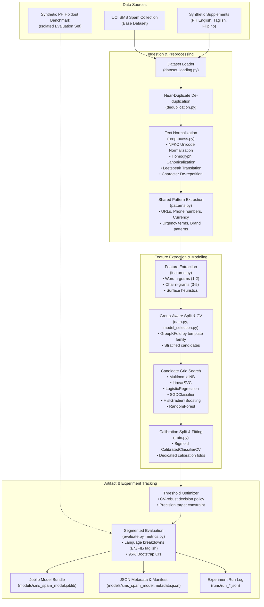

# System Architecture & Design

This document details the architectural blueprint of the Philippine SMS Spam and Scam Detector (`philippine-sms-spam-detector` v2.0.0), covering offline dataset processing & training pipelines, runtime inference services, web interface integration, and active learning feedback loops.

---

## 1. Offline ML Pipeline & Model Training Flow

The offline training subsystem loads, normalizes, extracts features, performs hyperparameter model selection, evaluates with group-aware cross-validation, calibrates probability estimates, and exports a production bundle.



---

## 2. Real-Time Inference & Serving Architecture

The online serving subsystem is built with **FastAPI** and **Starlette**, packaged in a container running as a non-root user (`smsd`). It enforces defence-in-depth security policies, per-IP rate limiting, request size limits, and asynchronous offloading for CPU-bound scikit-learn models.

```mermaid
flowchart TD
    CLIENT["Client<br/>(Web Browser / API Consumer)"]

    subgraph Edge & Middleware Stack
        CORS["CORS Middleware<br/>(Explicit SMSD_CORS_ORIGINS allowlist)"]
        SEC["Security Headers & CSP<br/>(default-src 'self', script-src 'self')"]
        RL["Rate Limiter Middleware<br/>(slowapi / In-memory sliding window)"]
        SZ["Request Body Limit<br/>(max_length=1600 per message)"]
        LOG["Structured JSON Logging<br/>(Latency, status, request_id — NO PII)"]
    end

    subgraph API Router Layer (api/routes.py)
        V1_ANALYZE["POST /v1/analyze<br/>POST /analyze (compat)"]
        V1_PREDICT["POST /v1/predict<br/>POST /predict (compat)"]
        V1_BATCH["POST /v1/batch<br/>POST /batch (compat)"]
        HEALTH["GET /health<br/>GET /v1/health"]
    end

    subgraph Async Threadpool Execution
        THREAD["asyncio.to_thread(...)<br/>(Prevents blocking event loop)"]
        PREPROC["Inference Preprocessing<br/>(preprocess.py, patterns.py)"]
        MODEL_INF["Model Predict / Decision<br/>(predict.py)"]
    end

    subgraph Frontend Client (api/web/)
        UI["Modular Vanilla JS Web UI<br/>• api-client.js<br/>• connection-status.js<br/>• history-store.js<br/>• privacy-preview.js<br/>• result-format.js"]
        DOM["DOM Rendering Engine<br/>• Strict textContent (XSS immune)"]
    end

    CLIENT --> CORS
    CORS --> SEC
    SEC --> RL
    RL --> SZ
    SZ --> LOG
    LOG --> V1_ANALYZE & V1_PREDICT & V1_BATCH & HEALTH

    V1_ANALYZE & V1_PREDICT & V1_BATCH --> THREAD
    THREAD --> PREPROC
    PREPROC --> MODEL_INF
    MODEL_INF --> THREAD
    THREAD --> LOG

    UI --> CLIENT
    CLIENT --> DOM
```

---

## 3. Feedback & Active Learning Triage Loop

User feedback submitted via the UI or API (`/feedback`) is collected in an anonymized, audited store and passed through automated filtering and deduplication before candidate retraining batches are generated.

```mermaid
sequenceDiagram
    autonumber
    actor User as User / Reviewer
    participant API as FastAPI (/feedback)
    participant Store as Feedback Store (JSONL)
    participant AL as Active Learning (active_learning.py)
    participant Train as Model Retraining (train.py)

    User->>API: Submit feedback (label, masked text, confidence, consent)
    API->>Store: Append validated anonymized record
    Note over Store: PII-free; only consented feedback stored

    loop Periodic / Triggered Triage
        AL->>Store: Ingest accumulated feedback
        AL->>AL: Normalize text (NFKC, homoglyphs, leetspeak)
        AL->>AL: Deduplicate against existing training dataset
        AL->>AL: Filter by label agreement & confidence criteria
        AL-->>Train: Generate candidate retraining batch (CSV)
    end

    Train->>Train: Train candidate model with group-aware CV
    Train->>Train: Run regression suite & quality gates
    Note over Train: Threshold validation against holdout benchmark
```

---

## 4. Architectural Invariants & Privacy Guarantees

1. **Zero Message Retention on Server**: Raw message text sent to `/predict`, `/analyze`, or `/batch` is processed strictly in-memory and discarded. It is never logged to stdout, syslog, disk, or remote monitoring sinks.
2. **Deterministic Preprocessing Pipeline**: All inputs go through `unicodedata.normalize("NFKC")`, homoglyph canonicalization, and leetspeak substitution before feature extraction to prevent evasion.
3. **Defense-in-Depth Web Security**:
   - `Content-Security-Policy` limits script and style loading exclusively to `'self'`.
   - Explicit CORS origins prevent unauthorized browser-origin cross-site requests.
   - Per-IP rate limiting guards against brute-force harvesting or denial-of-service.
   - Text rendering on the frontend strictly utilizes `textContent` and parameterized DOM construction to eliminate cross-site scripting (XSS).
4. **Reproducible Experiment Logs**: Every model training invocation produces immutable artifacts: `.joblib` model bundle, `.metadata.json` model card & metric breakdown, `.manifest.json` dataset provenance hashes, and run records under `runs/`.
